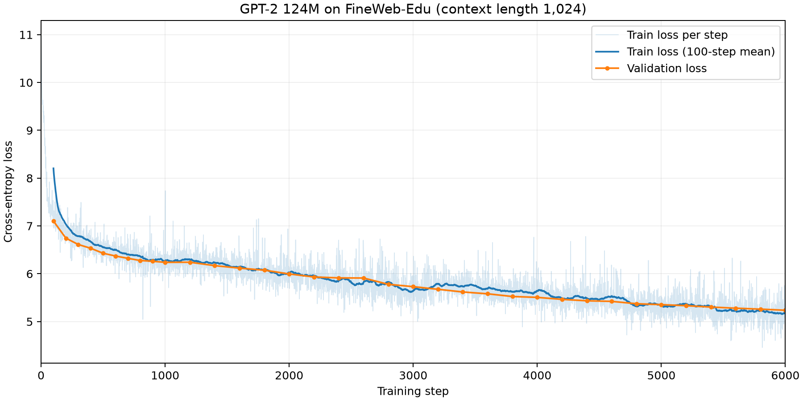

# gpt-2-from-scratch

## 목표

Andrej Karpathy의 GPT-2 from scratch 강의를 바탕으로

GPT-2 124M을 Pytorch로 구조를 직접 구현하고, 

FineWeb-Edu의 일부 데이터로 다음 토큰 예측을 학습한다. 

## 참고 영상 (Reference)
Andrej Karpathy, Let's reproduce GPT-2(124M) (https://www.youtube.com/watch?v=l8pRSuU81PU)


## 파일 구성

| 파일 | 역할 |
|---|---|
| `train_gpt2.py` | GPT-2 모델, 데이터 로더, 학습률 스케줄 구현 |
| `run_gpt2.py` | 학습·검증 실행, 체크포인트 저장, 텍스트 생성 (환경에 맞게 코드 변경 위해 Codex 일부 사용) |
| `fineweb.py` | FineWeb-Edu 다운로드 및 토큰화 |
| `GPT2_Train_Colab.ipynb` | Colab에서 데이터 준비 및 학습 실행 (Codex 생성) |
| `requirements.txt` | 필요 패키지 목록 |

## 실험 설정 및 결과

로컬 컴퓨팅 자원의 제약으로 학습은 Google Colab의 GPU로 진행함.

제한된 학습 시간과 연산 자원을 고려해 FineWebEdu Sample-10BT의 일부만 사용함.

| 항목 | 설정 |
|---|---|
| 모델 | GPT-2 124M |
| 학습 데이터 | FineWeb-Edu `sample-10BT` 일부 |
| 실행 환경 | Google Colab, Tesla T4 |
| 문맥 길이 | 1,024토큰 |
| 업데이트당 학습량 | 2 * 1024 * 4 = 8,192토큰 |
| 학습량 | 6,000steps, 총 49,152,000토큰 |


validation loss는 100스텝의 **7.1026**에서 6,000스텝의 **5.2366**으로 감소함.

학습량이 제한되어 검증 loss가 하락하는 도중에 학습을 종료함. 

추가 학습을 통해 검증 loss가 더 감소하는지 확인할 필요가 있음.


## train 및 validation Loss




## 텍스트 생성 예시

6,000스텝 학습된 모델로 
- mode = 'generate'
- prompt = `Hello, I'm a language model,`
- max_new_tokens = 40
- top_k = 50으로 설정 후 generate 한 결과 

```text
Hello, I'm a language model, and are all of their own work and to consider their experiences of their work. When a person or a child has access to the child or other child, the teacher is not the game.
```
